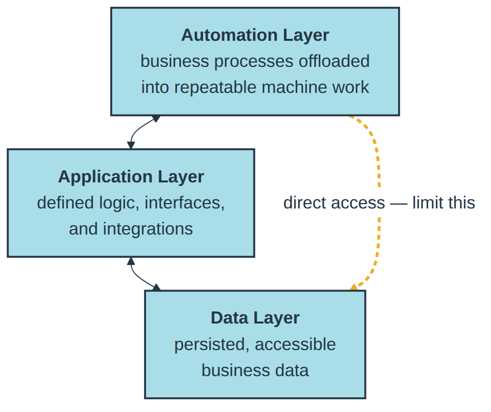
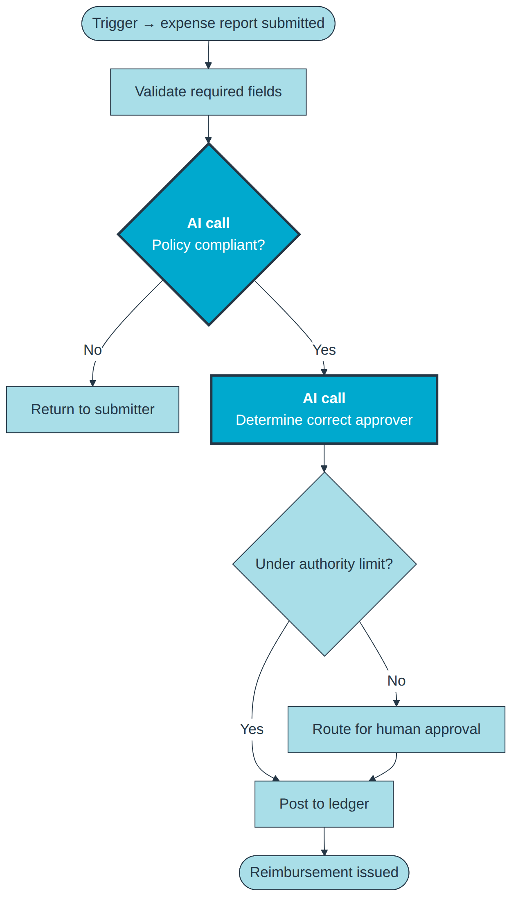
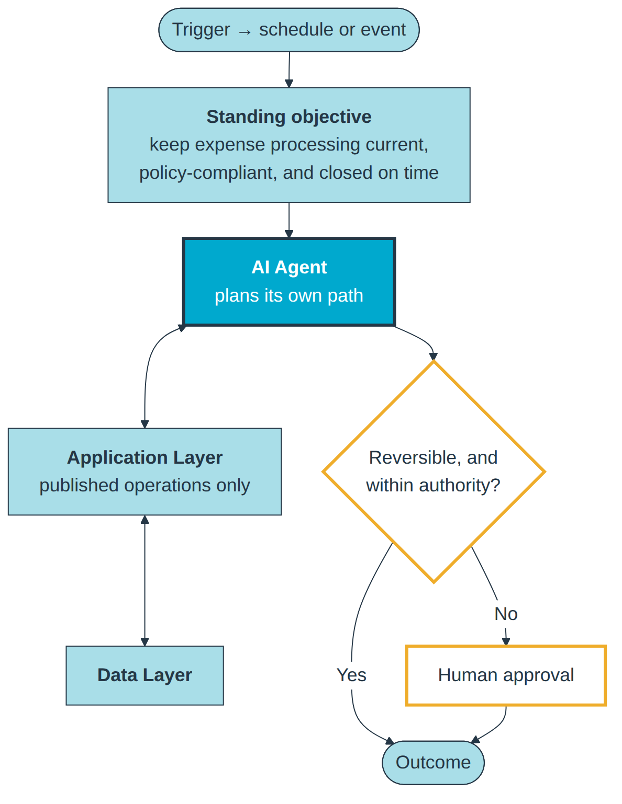

A business solution usually consists of three equally important pillars: the **automation layer**, the **data layer**, and the **application layer**. They need to be well integrated with each other.

## The Automation Layer

The automation layer is where business processes are offloaded from humans into repeatable jobs for machines. Historically, this was done using procedural code and rules that orchestrated all of the necessary components. These procedures needed to be maintained as the business evolved.

Nuances aside, Gartner now groups this market under the term ["business orchestration and automation technologies" (a.k.a. "BOAT")](https://www.gartner.com/reviews/market/business-orchestration-and-automation-technologies).

Today, the automation layer is primarily seen as something that should be solved with AI. This can take two different forms: **AI-in-the-Process** or **AI-as-the-Process**.

**AI-in-the-Process** bakes agent calls, machine learning-based prediction, and other inference into specific parts of an otherwise-procedural automation. This is the easiest form to evolve a non-AI automation into, because you can substitute AI-based decision making at specific points (offloading both human and rule engine maintenance) without overhauling the entire system your users trust.

**AI-as-the-Process** is the paradigm shift that allows an automation to self-evolve with a business for years. In this form, a well-equipped and well-integrated AI agent is given a long-standing objective, placed on a schedule or event-based invocation, and allowed to take its best perceived path to that outcome.

This is the scariest form for most customers, because it gives the perception that control is being removed from their hands. Guardrails are what turn that perception around, and they have to be specific enough to audit. Confidence-based human-in-the-loop is the obvious starting point, but confidence is self-reported — so pair it with gating on consequence, where reversible actions execute autonomously and irreversible ones, like issuing a payment or contacting a customer, route to a person first.

Two more worth stating plainly: bound the agent's authority numerically, so that it can only approve invoices under $5K, issue no more than a handful of credits in a day, or operate against a single legal entity. And treat autonomy as earned rather than granted, by running the agent in shadow mode first — live against real data, committing nothing — until its judgment has been measured against the process it is replacing. Control is not being taken away; it is being spent deliberately.

With those in place, AI-as-the-Process is the efficiency multiplier everyone is actually chasing.

My recommendation for those starting their journey with AI is to take an existing automation and find specific routines within it that can be replaced with AI-in-the-Process. Good candidates are rule-based decisions, where the rules previously were hardcoded and needed to be manually updated whenever the business evolved.

Once you're comfortable with AI-in-the-Process, the next step is to grow into AI-as-the-Process for key automations, so that they can intelligently evolve with the business.

Automations alone accomplish nothing. They need to integrate with business logic (the application layer) and business data (the data layer) to actually achieve the desired outcomes.

## The Data Layer

In some ways, the effect of the AI movement on the data layer has been the quietest of the three. Business data — customers, inventory, financials, sales, quality, and so on — simply has to be persisted and accessible somewhere efficient. This is just as crucial now as it was before computers ever existed.

And it is this business data that gives processes, whether legacy or AI-infused, the ammunition they need to execute against reality. It is perhaps the most valuable proprietary asset a business actually has.

In the early days of AI agents, there was hype around throwing them directly at a database. In other words, people were trying to let agents write and execute raw SQL statements as they saw fit. While the flexibility of this approach is impressive, many limitations surface:

- The agents lack semantic understanding of the data, which is often stored in a data model normalized for use by a specific application.
- The agents can't behave in a provably trustworthy way, even when given their own roles and permissions. The data layer is foundational, valuable, and must be protected; most humans aren't even given direct access to it for this reason.
- The agents will theoretically run any query against the database, meaning design-time query planning and performance optimization are almost impossible.

Semantic layers, metric layers, knowledge graphs, and retrieval over embedded schema each took a real run at these limitations. They make the data more legible to an agent, which is genuinely useful. But none of them make the agent's actions against or with that data provably safe, nor make an arbitrary generated query performant at design time, nor make deterministic business routines available to an agent. Those gaps are solved in the application layer — and the market has spent a few years rediscovering that.

When an agent is able to plan and build its own data model from scratch, treating the data model and database more like its own notebook, direct access can be effective. But, for most other use cases — especially when modernizing a solution with AI — the application layer is what appropriately bridges the gap between the automation layer and the data layer.

## The Application Layer

The application layer is where three things live: the logic that acts against the data layer, the interfaces for accessing that data and executing that logic, and the integrations to other systems. It has experienced a fundamental paradigm shift as part of the AI movement.

The application layer was previously designed for human consumption. Now, it is increasingly designed for AI consumption. This is the "AI-first" or "AI-native" qualifier that has become popular.

This paradigm shift has permeated everything. Websites now carry files and directories most humans will never see, written specifically for AI to read (e.g., `llms.txt` and AI-specific entries in the `/.well-known` directory), and many are optimized for AI discovery through GEO, AIO, and AEO in addition to SEO. Many services are prioritizing their MCP interfaces, which act as a UI-less application for agents to drive, over REST-based and UI-based interfaces — and many newer services are forgoing a human-focused UI altogether.

It is this AI-native application layer that enables the automation layer to safely interact with the data layer, integrate out to other systems' application layers, and perform the work necessary to streamline a complete business process. It is also where the guardrails described earlier stop being policy and become structure — the difference between telling an agent not to do something and leaving it no mechanism to.

Three examples of that distinction: the agent authenticates as its own principal, subject to the same role and permission model as a human user, with no ambient superuser path to fall back on. It can invoke only the operations the application layer chooses to publish, which makes that published surface area the sandbox. And its writes are validated by the same business rules that reject a human's bad data entry, so there is no privileged path around them. These are guardrails an auditor can inspect rather than ones a vendor asks you to take on faith.

## You Need All Three

An automation without anything to automate is useless. A data layer without a way to touch the data is useless. And an application layer without a driver or anything to drive is useless.

Many of the products that entered the market as part of the AI movement only solved for one of the three layers in the trifecta. This led to an incredibly heavy emphasis on integrations, which always sound more convenient on paper than they are to actually implement. It also led to a rapid onset of obsolescence as products with deeper pockets expanded into additional layers of the trifecta.

My suggestion is to look for a builders' platform that has an answer to all three layers of the trifecta. Integration capabilities are still important, so that the platform you pick can leverage your entire enterprise ecosystem. But having all three architectural components of your core solution on the same platform significantly reduces cognitive and maintenance complexity.
